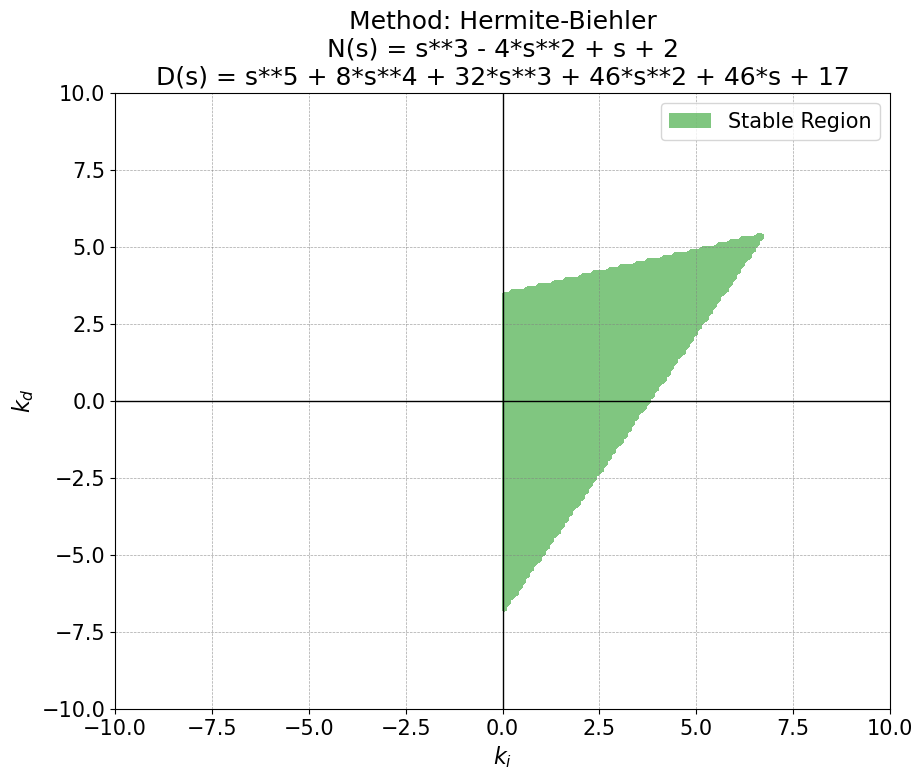
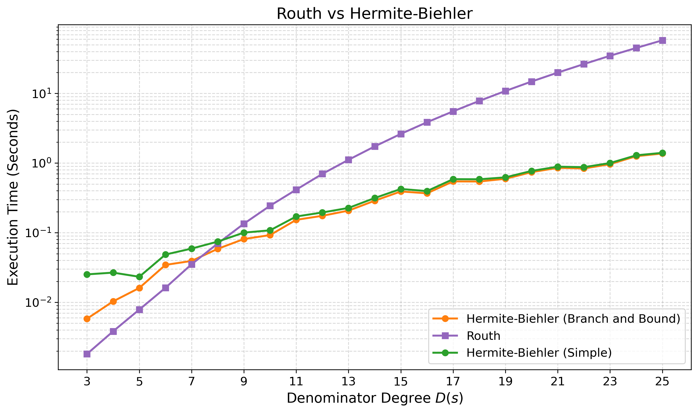

# SymPID

This repository provides a Python library to find the complete set of stabilizing PID controllers for any linear time-invariant (LTI) plant. It calculates the stability regions in the $(k_p, k_i, k_d)$ parameter space using exact polynomial arithmetic via SymPy.

## Stability Calculation Methods

- **Hermite-Biehler (Core Implementation)**: Uses `calculate_pid_stability_conditions_backtracking`. By sampling $k_p$, it generates a set of linear inequalities in the $(k_i, k_d)$ plane. This mathematical approach is generally **much faster than Routh-Hurwitz**. To satisfy the theorem's constraints, the algorithm finds valid sign strings using an optimized **backtracking** method instead of naive brute-force. The backtracking effectively prunes invalid combinations early, providing a significant speedup for low-degree polynomials. However, at higher degrees, this advantage over brute-force diminishes because finding the numerical roots of $q(\omega)$ (as defined in the paper) becomes the main computational bottleneck.
- **Routh-Hurwitz (SymPy Built-in)**: Uses `hurwitz_conditions()` on the closed-loop characteristic polynomial. It generates exact, non-linear conditions in the 3D space without sampling $k_p$, but it scales poorly and is computationally much slower.

## Additional Utilities

- **Plotting**: 2D and 3D visualization functions to plot stability boundaries and regions using Matplotlib.
- **Benchmarking**: Scripts to test the scaling of the different computational approaches as the plant degree increases.

## Files Structure

- `pid_stabilizer.py`: The core mathematical library. Contains the logic for the Hermite-Biehler stability criteria.
- `plotting.py`: Visualization tools for plotting the stability regions generated by the core library in 2D and 3D.
- `benchmark.py`: A script to benchmark the performance and showcase example usages of the algorithms.

## Usage Example

```python
from sympy import Poly, symbols
from sympy.abc import s
from pid_stabilizer import calculate_pid_stability_conditions_backtracking
from plotting import plot_stability_region

# Define Plant Transfer Function
# Example: G(s) = (s^3 - 4s^2 + s + 2) / (s^5 + 8s^4 + 32s^3 + 46s^2 + 46s + 17)
N = Poly(s**3 - 4*s**2 + s + 2, s)
D = Poly(s**5 + 8*s**4 + 32*s**3 + 46*s**2 + 46*s + 17, s)

# Calculate conditions for Kp = 1
conditions = calculate_pid_stability_conditions_backtracking(N, D, kp_val=1)

# Plot the 2D stability region for Kp = 1
plot_stability_region(conditions, N, D, plot_id="example")
```

This will produce an image named `stability_PID_example.png`:



## Benchmark



## References

- Ming-Tzu Ho, A. Datta and S. P. Bhattacharyya, "[A linear programming characterization of all stabilizing PID controllers](https://ieeexplore.ieee.org/abstract/document/609624)," Proceedings of the 1997 American Control Conference (Cat. No.97CH36041), Albuquerque, NM, USA, 1997, pp. 3922-3928 vol.6, doi: 10.1109/ACC.1997.609624.
